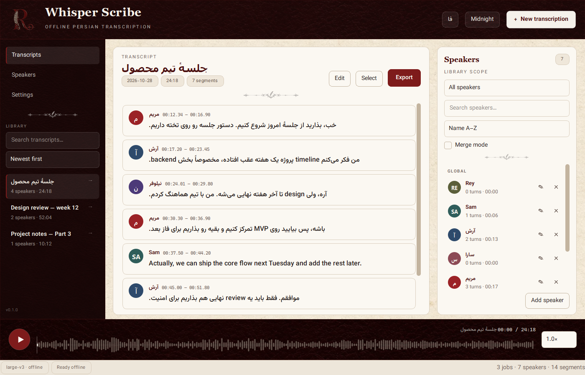
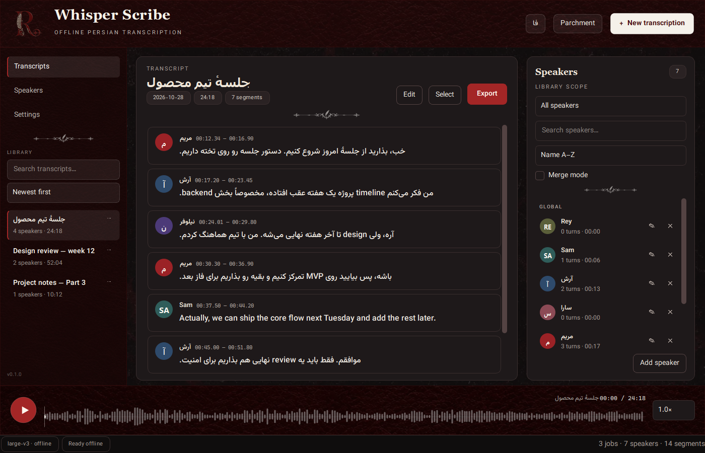

# Whisper Scribe

Whisper Scribe is a local Windows desktop application for transcribing Persian, English, and mixed-language audio and video. It produces speaker-labelled transcripts with timestamps, playback, editing, and TXT/SRT export. Audio never leaves the machine after the models are installed.



<p align="center"></p>

## Features

- Persian (`fa`), English (`en`), mixed Persian/English, and auto-detect modes
- Whisper **large-v3** by default, with an optional Turbo model
- Speaker diarization, labelled transcript lines, and word-level timestamps
- Grouped, searchable, sortable speaker library with rename, merge, delete, and manual add
- Per-line speaker correction: select transcript lines and assign them to a speaker
- Single-click transcript editing, click-to-seek playback, and TXT/SRT export
- Transcript search, sorting, rename, delete, export, and reveal-source actions
- Optional per-job context and vocabulary fields for domain-specific terms and names
- Settings for theme, interface language, and new-job defaults
- Live progress, elapsed time, cancellation, and English/Persian RTL UI
- Offline operation after model installation; local database and exports

## Requirements

- Windows 11 (64-bit)
- Python 3.13 (development and EXE build only)
- FFmpeg on `PATH` (development only; the portable EXE build copies it)
- NVIDIA GPU with a CUDA 12.6 driver strongly recommended
- About 8 GB free disk space for packages and models

## Installation

### 1. Enter the repository

```powershell
git clone https://github.com/ReyIsHere9/Rey_Whisper_Scribe.git
cd Rey_Whisper_Scribe
```

### 2. Create the environment

```powershell
python -m venv .venv
.venv\Scripts\Activate.ps1
python -m pip install --upgrade pip

pip install -r requirements.txt

# GPU (CUDA 12.6):
pip install torch==2.11.0 torchaudio==2.11.0 --index-url https://download.pytorch.org/whl/cu126

# CPU only (slower):
# pip install torch==2.11.0 torchaudio==2.11.0

pip install -r requirements-ml.txt
```

### 3. Install FFmpeg

```powershell
winget install --id Gyan.FFmpeg -e
```

Open a new terminal afterwards.

### 4. Hugging Face access

Speaker diarization uses a gated model. This is required once per Hugging Face account:

1. Create a **read** token: <https://huggingface.co/settings/tokens>
2. Accept the model terms: <https://huggingface.co/pyannote/speaker-diarization-community-1>
3. Save the token in `tokenhg.txt` at the project root, or set `HF_TOKEN`.

`tokenhg.txt` is git-ignored. Do not commit it.

If speaker labels are not needed, skip the token and clear **Separate speakers** in the New Transcription dialog.

### 5. Download models

From the project root:

```powershell
download_models.bat
```

If the Whisper download is interrupted, use the resumable downloader:

```powershell
powershell -ExecutionPolicy Bypass -File tools\download_whisper_curl.ps1
```

Sources:

- Whisper: [`Systran/faster-whisper-large-v3`](https://huggingface.co/Systran/faster-whisper-large-v3)
- Diarization: [`pyannote/speaker-diarization-community-1`](https://huggingface.co/pyannote/speaker-diarization-community-1)

### 6. Run

```powershell
run.bat
```

or:

```powershell
.venv\Scripts\python.exe -m app.main
```

## Portable Windows EXE

```powershell
pip install -r requirements-dev.txt
build_exe.bat
```

Output:

```text
dist\WhisperScribe\WhisperScribe.exe
```

Distribute the entire `dist\WhisperScribe` folder, not only the EXE. It contains the runtime, models, FFmpeg, and local data. The folder is approximately 7.5 GB because it includes CUDA PyTorch and Whisper large-v3.

The build stages and restores `data`, `models`, `ffmpeg`, and `README.txt`, so rebuilding does not erase transcripts or exports.

Diagnostics:

```powershell
.\WhisperScribe.exe --selftest C:\path\to\audio.wav --selftest-output selftest.txt
```

If the application fails before opening, see `startup-error.log` next to the EXE.

## Model and data locations

By default everything is kept inside the project:

```text
<repo>\models\large-v3
<repo>\models\hf\hub
<repo>\data\whisper_scribe.db
<repo>\data\exports
```

`models\`, `data\`, `logs\`, `shots\`, and `dist\` are git-ignored.

To use another model location, set `WHISPERSCRIBE_MODELS` to the folder containing `large-v3`:

```powershell
setx WHISPERSCRIBE_MODELS "X:\Models\WhisperScribe"
```

Whisper and the diarization cache can be copied between machines. A token is only needed if diarization has to be downloaded again.

## Usage

1. Click **New transcription** or drop an audio/video file on the window.
2. Choose the language:
   - **Persian** for mostly Persian material.
   - **Mixed** for genuinely mixed Persian/English material (auto-detect).
   - **English** for English.
   - **Auto** to let Whisper decide.
3. In **Advanced**, optionally set expected speakers and provide a context prompt or vocabulary list.
4. Click **Start**. Progress and cancellation are available in the status bar.
5. When complete, play the audio, edit lines, adjust speakers, and export TXT/SRT.

Exports default to `<repo>\data\exports`.

### Editing

Click **Edit**, then single-click any transcript line. Type the correction and press Enter. The editor respects Persian right-to-left text.

### Transcript management

Use the sidebar search and sort controls to find a transcript. The `⋯` menu provides:

- Rename
- Export
- Show source file
- Delete (removes the library entry and database record; the original media file is not deleted)

### Speaker management

- The speaker panel can show **All speakers**, the **Global** library, or only **This job**.
- All speakers are grouped into Global and This job sections, with search and sorting by name, turns, or speaking time.
- Use the pencil to rename a speaker.
- Use **×** to delete a speaker. Its transcript lines become unassigned; the text remains.
- **Merge mode** combines two labels that represent the same person.
- **Add speaker** creates an empty entry for manual labelling.
- To correct a single line, click **Select**, choose one or more lines, then **Assign N to speaker…**.

### Context and vocabulary

For domain-specific content, open **Advanced** in the New Transcription dialog and provide:

- **Context / domain prompt**: a sentence describing the subject or terminology.
- **Vocabulary / names**: comma-separated terms, names, or jargon.

These fields bias decoding toward the supplied terms. Large-v3 remains the default and most accurate bundled model; custom vocabulary is the recommended way to improve domain-specific spelling.

### Settings

Click **Settings** in the sidebar to change:

- Theme and interface language
- Default language, model, expected speakers, speaker scope, and diarization
- Open the models or data folders

## Troubleshooting

**`403 Forbidden` or “gated model”**

Accept the terms at <https://huggingface.co/pyannote/speaker-diarization-community-1> and ensure `tokenhg.txt` contains a valid read token.

**“Transcription engine not installed”**

Install the ML dependencies:

```powershell
pip install -r requirements-ml.txt
```

**CUDA is not used**

```powershell
python -c "import torch; print(torch.cuda.is_available(), torch.cuda.get_device_name(0))"
```

Install the CUDA build of PyTorch as shown in the installation section.

**Whisper download stalls**

Use `tools\download_whisper_curl.ps1`. The downloader disables the Xet transfer path.

**`ffmpeg` not found**

Install FFmpeg and add its `bin` folder to `PATH`, then reopen the terminal. The portable build includes FFmpeg in `ffmpeg\`.

**The EXE closes immediately**

Check `startup-error.log` next to `WhisperScribe.exe`. Keep the application in a writable folder, not `C:\Program Files`.

## Development

```powershell
pytest -q
ruff check .
```

Regenerate visual assets from the design masters:

```powershell
$env:WHISPERSCRIBE_ASSET_MASTERS = "X:\Assets\Whisper-Scribe"
python tools\build_assets.py
```

Project layout:

```text
app/
  core/       transcription, diarization, pipeline, audio, export, normalization
  ui/         PySide6 widgets, dialogs, worker thread, i18n
  db/         SQLite schema and data access
  theme/      palettes and stylesheet
  assets/     generated textures, icons, fonts
tools/        model downloaders, smoke test, asset builder
tests/        pytest suite
docs/         README screenshots
```

## Credits

- [faster-whisper](https://github.com/SYSTRAN/faster-whisper) and [OpenAI Whisper](https://github.com/openai/whisper)
- [pyannote.audio](https://github.com/pyannote/pyannote-audio)
- [PySide6 / Qt for Python](https://doc.qt.io/qtforpython/)
- [Vazirmatn font](https://github.com/rastikerdar/vazirmatn) (SIL Open Font License)
- [FFmpeg](https://ffmpeg.org/)
- Branding and visual design: Rey
