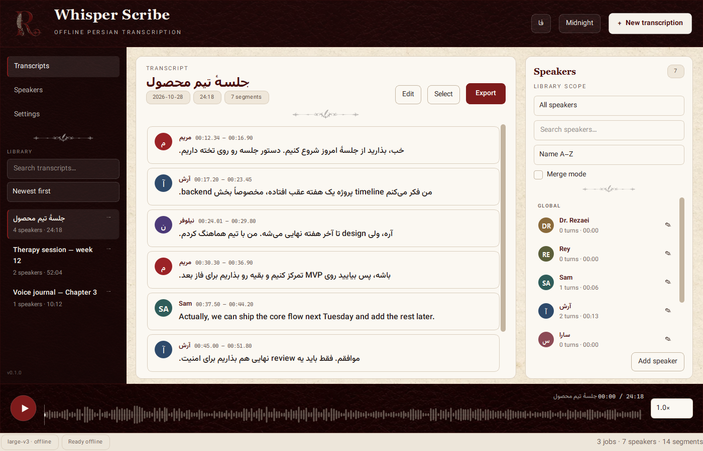
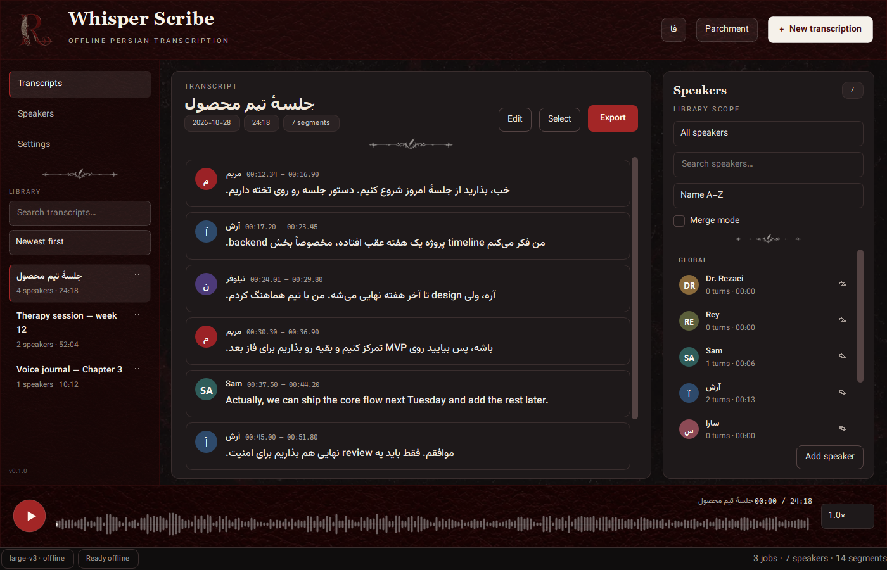

# Whisper Scribe

Offline transcription for **Persian, English, and mixed Persian/English** recordings, with speaker labels, playback, editing, and TXT/SRT export.

Whisper Scribe is a Windows desktop app built with PySide6, [faster-whisper](https://github.com/SYSTRAN/faster-whisper), and [pyannote.audio](https://github.com/pyannote/pyannote-audio). Audio stays on your machine. The only network use is the one-time model download.



<p align="center"></p>

## Features

- Persian (`fa`), English (`en`), mixed Persian/English, and auto-detect modes
- Whisper **large-v3** by default (optional Turbo model)
- Word-level timestamps and speaker diarization
- Global or per-job speaker library, grouped speaker sections, search/sort, merge, rename, and manual add
- Per-line speaker correction: select one or more transcript lines and assign them to a speaker
- Transcript search/sort, rename, delete, show source, and TXT/SRT export
- Click-to-seek playback and single-click transcript editing
- Settings for theme, language, and new-job defaults
- Live progress, elapsed time, and cancel while transcribing
- Bundled Vazirmatn Persian typography and readable larger UI text
- English and Persian/RTL UI, light and dark themes
- Everything runs locally after the models are downloaded

## Requirements

- Windows 11 (64-bit)
- Python 3.13 (only needed for development and building the EXE)
- FFmpeg on `PATH` (only needed for development; the EXE build copies it)
- NVIDIA GPU with a CUDA 12.6 driver **strongly recommended** (CPU works, but is much slower)
- About 8 GB free disk space for Python packages and models

## Installation

### 1. Get the code

```powershell
git clone https://github.com/ReyIsHere9/Rey_Whisper_Scribe.git
cd Rey_Whisper_Scribe
```

### 2. Create the environment and install dependencies

```powershell
python -m venv .venv
.venv\Scripts\Activate.ps1
python -m pip install --upgrade pip

pip install -r requirements.txt

# GPU (CUDA 12.6):
pip install torch==2.11.0 torchaudio==2.11.0 --index-url https://download.pytorch.org/whl/cu126

# CPU only (slower):
# pip install torch==2.11.0 torchaudio==2.11.0

pip install -r requirements-ml.txt
```

Install FFmpeg if you do not have it:

```powershell
winget install --id Gyan.FFmpeg -e
```

Open a new terminal after installing FFmpeg so the `ffmpeg` command is found.

### 3. Get a Hugging Face token and accept the diarization model

Speaker diarization uses a gated model. You only need to do this once per Hugging Face account:

1. Create a **read** token: <https://huggingface.co/settings/tokens>
2. **Accept the terms** (click **Agree and access repository**):
   **<https://huggingface.co/pyannote/speaker-diarization-community-1>**
3. Save the token on a single line in `tokenhg.txt` at the root of this project, or set the `HF_TOKEN` environment variable.

```text
hf_your_read_token_here
```

`tokenhg.txt` is ignored by git. Never commit it. A token is required only for the first diarization download; a machine that only loads an already-copied model cache can work fully offline.

> If you do **not** need speaker labels, you can skip the token and uncheck speaker diarization in the Advanced section of the New Transcription dialog. Whisper will still transcribe the file.

### 4. Download the models

Run these commands from the project root. The easy way (Whisper + diarization, with a log in `logs/download_models.log`):

```powershell
download_models.bat
```

If the Whisper download stalls or gets interrupted, use the resumable downloader:

```powershell
powershell -ExecutionPolicy Bypass -File tools\download_whisper_curl.ps1
```

This downloads the files from the public Hugging Face repositories:

- Whisper: [`Systran/faster-whisper-large-v3`](https://huggingface.co/Systran/faster-whisper-large-v3) — about **2.9 GB**, stored in `<repo>\models\large-v3`
- Diarization: [`pyannote/speaker-diarization-community-1`](https://huggingface.co/pyannote/speaker-diarization-community-1) — stored in `<repo>\models\hf\hub`

### 5. Run

```powershell
run.bat
```

or:

```powershell
.venv\Scripts\python.exe -m app.main
```

`run.bat` creates the virtual environment and installs the lightweight UI dependencies if they are missing. The heavy ML dependencies from step 2 must be installed once manually.

## Portable Windows EXE

Build a double-clickable, self-contained app folder:

```powershell
pip install -r requirements-dev.txt
build_exe.bat
```

Output:

```text
dist\WhisperScribe\WhisperScribe.exe
```

Keep or share the **entire** `dist\WhisperScribe` folder. It contains the EXE, the Python/Qt/ML runtime, `models\`, `ffmpeg\`, and a `data\` folder created on first run. No Python or FFmpeg installation is needed on the target PC.

The folder is about **7.5 GB** because it contains CUDA PyTorch and the large-v3 model. This is a one-folder build, not a single-file EXE: a single file would unpack several gigabytes on every launch.

`build_exe.bat` copies `models` and the system `ffmpeg.exe`/`ffprobe.exe` next to the EXE. If FFmpeg is not on `PATH`, copy those two files into `dist\WhisperScribe\ffmpeg\`.

Keep the app in a writable folder (not `C:\Program Files`) so it can create `data\` and write exports.

Diagnostics for the built EXE:

```powershell
.\WhisperScribe.exe --selftest C:\path\to\audio.wav --selftest-output selftest.txt
```

The windowed EXE writes the result to `selftest.txt`. If it fails before the window appears, check `startup-error.log` next to the EXE.

`build_exe.bat` stages and restores the existing `data`, `models`, `ffmpeg`, and `README.txt` around the rebuild, so transcripts and exports are not erased when you rebuild.

## Where the models live (and copying to another PC)

Everything stays inside the project folder:

```text
<repo>\models\large-v3\model.bin
<repo>\models\hf\hub\models--pyannote--speaker-diarization-community-1
```

`models\` and `data\` are git-ignored. Copy the whole `models` folder to another checkout on another PC and the app will use it; no re-download is needed for either Whisper or diarization.

If you keep models somewhere else (for example an external drive), set `WHISPERSCRIBE_MODELS` to the folder that **contains** `large-v3`:

```powershell
setx WHISPERSCRIBE_MODELS "E:\Models\WhisperScribe"
```

The Hugging Face cache follows that folder (`<that folder>\hf\hub`). A token is only needed on a machine that has to download the diarization model for the first time.

Optional: the **Turbo** model is available in Advanced options. It is not downloaded by default; selecting it downloads `large-v3-turbo` on first use.

## Using the app

1. Click **New transcription** (or drag a file onto the window).
2. Choose an audio or video file.
3. Pick a language:
   - **Persian** — forces Persian; English words are usually kept in Latin script.
   - **Mixed (Persian + English)** — auto-detects; recommended for Persian meetings with English terms.
   - **English** — forces English.
   - **Auto detect** — Whisper decides.
   If a mixed file starts with a long English intro, Whisper may auto-detect English; in that case choose **Persian** instead.
4. Optional (Advanced): set **Expected speakers**. `Auto` (0) is the best default; set a number if you know it.
5. Click **Start**. Progress, elapsed time, and a **Cancel** button appear at the bottom.
6. When finished: play the audio, click a transcript line to seek, edit text, fix speaker labels, merge speakers, or export TXT/SRT.

Exports default to `<repo>\data\exports`.

### Editing, searching, and organizing transcripts

- Click **Edit**, then **single-click any transcript line** to edit it. Press Enter to save. The line editor supports Persian right-to-left text.
- Use the **Search transcripts** field and **Sort** menu in the sidebar to find jobs.
- Click the **⋯** menu on a transcript card to **Rename**, **Export**, **Show source file**, or **Delete** it.
- Deleting a transcript removes it from the library and database only. The original audio/video file is not deleted.

### Settings

Click **Settings** in the sidebar to change:

- Theme (Parchment / Midnight) and interface language
- Default language, model, expected speakers, speaker scope, and diarization for new jobs
- Open the models or data folders directly


### What diarization is

Diarization is the **“who spoke when”** pass. It splits the audio into speaker turns and labels each transcript segment with a speaker (`Speaker 00`, `Speaker 01`, …). It never combines people's text into one block and it never rewrites the transcript. It only adds a speaker label to each line.

### Fixing a wrong speaker label

**Merge mode** in the speaker panel is speaker-level: it tells the app that two labels are the same person, so all segments of one label move to the other. The text stays as separate lines.

To fix a single line (for example when someone talks between two people):

1. Click **Select** in the transcript header.
2. Click one or more transcript lines; they get a checkbox and an accent border.
3. Click **Assign N to speaker…**.
4. Choose an existing speaker or **New speaker…**.

Only the selected segments change. The timeline, text, and all other lines stay untouched. Click **Done** to leave selection mode.

Other speaker tools:

- The speaker panel shows **All speakers**, only the **global library**, or only **this job**.
- All view is split into **Global** and **This job** sections, with search and sort (name, turns, speaking time) so the list stays manageable.
- Click the **pencil** beside a speaker (or double-click the speaker) to rename it.
- **Merge mode** combines two labels when diarization split one person into two.
- **Add speaker** creates an empty speaker entry for manual labeling.
- Voice enrollment is not part of this build yet.

### Persian accuracy tips

- For a mostly Persian file, choose **Persian** rather than **Mixed**. Mixed uses Whisper language auto-detection, which can pick the wrong language if the file starts with English.
- Keep the model on **large-v3 · best accuracy**; Turbo is faster but less accurate.
- The app loudness-normalizes extracted audio and uses a Persian prompt plus previous-context conditioning to improve punctuation and continuity.
- Use the cleanest source audio you have; background music and heavy noise still hurt Whisper accuracy.
- Set **Expected speakers** only when you actually know the number; otherwise leave it on Auto.

### Privacy and local data

- Audio and transcripts are processed locally.
- Everything is under the project: `<repo>\models`, `<repo>\data`, `<repo>\logs`.
- Database: `<repo>\data\whisper_scribe.db`
- Exports: `<repo>\data\exports`
- Delete the database file to reset the demo library and all jobs.
- `models\`, `data\`, `logs\`, and `shots\` are git-ignored.

## Performance

Whisper large-v3 is accurate but heavy. On an RTX 4070 Laptop, a 2-hour recording typically takes roughly 10–30 minutes to transcribe and another 5–15 minutes to diarize, depending on speech density and silence. The app shows live progress and elapsed time.

- Cancel works during transcription. Diarization is a single model pass and cannot be interrupted mid-stage; cancellation takes effect after it finishes.
- The first model load after launch takes a few seconds.
- CPU-only processing is much slower; GPU is strongly recommended.

## Troubleshooting

**`403 Forbidden` or “gated model”**
Accept the terms while logged in as the token owner:
<https://huggingface.co/pyannote/speaker-diarization-community-1>
Then make sure `tokenhg.txt` contains a valid read token (or set `HF_TOKEN`).

**“Transcription engine not installed”**
Install the heavy dependencies:
```powershell
pip install -r requirements-ml.txt
```

**CUDA is not used**
Check the GPU stack:
```powershell
python -c "import torch; print(torch.cuda.is_available(), torch.cuda.get_device_name(0))"
```
Reinstall the CUDA build of torch from the command in step 2.

**Whisper download stalls**
Use `tools\download_whisper_curl.ps1`. The app and downloader set `HF_HUB_DISABLE_XET=1` to avoid the Xet transfer path, which can stall on some networks.

**`ffmpeg` not found**
Install FFmpeg and add its `bin` folder to `PATH`, then reopen the terminal.

**Model loading is slow the first time**
Antivirus/Defender can scan the 3 GB model. Later launches are faster.

**`libtorchcodec` / FFmpeg DLL errors**
The app decodes extracted WAV files itself and passes tensors to pyannote, so diarization does not depend on torchcodec’s FFmpeg decoder. Keep `torchcodec==0.17.0` installed as required by pyannote; if you see an error, reinstall the exact versions from `requirements-ml.txt`.

**The EXE closes immediately or shows no window**
Check `startup-error.log` next to `WhisperScribe.exe`. It contains the traceback. The most common causes are a missing `models` or `ffmpeg` folder, or running from a non-writable location.

**The EXE cannot create `data` or `exports`**
Move the whole `dist\WhisperScribe` folder somewhere writable, such as `X:\Apps\WhisperScribe`.

**Long job and the app was closed**
On startup, a job that was processing is marked failed, unless partial transcript segments were already saved; in that case it is marked transcribed so you can still read/export them.

## Development

```powershell
pytest -q
ruff check .
```

Generated assets are committed. To rebuild them from the design masters:

```powershell
$env:WHISPERSCRIBE_ASSET_MASTERS = "X:\Assets\Whisper-Scribe"
python tools\build_assets.py
```

You can also pass `--masters "X:\Assets\Whisper-Scribe"`.

Take a screenshot (used for the README):

```powershell
python -m app.main --theme dark --lang en --screenshot shots/preview.png
```

Project layout:

```text
app/
  core/       transcription, diarization, pipeline, audio, export, normalization
  ui/         PySide6 widgets, dialog, worker thread, i18n
  db/         SQLite schema and data access
  theme/      palettes and stylesheet
  assets/     generated textures/icons
tools/        model downloaders, smoke test, asset builder
tests/        pytest suite
docs/         README screenshots
```

## شروع سریع (فارسی)

۱. پایتون ۳.۱۳ و FFmpeg را نصب کنید.
۲. محیط مجازی و وابستگی‌ها را نصب کنید (مرحله ۲ بالا).
۳. در سایت Hugging Face یک توکن Read بسازید و شرایط مدل تفکیک گوینده را بپذیرید:
<https://huggingface.co/pyannote/speaker-diarization-community-1>
سپس توکن را در فایل `tokenhg.txt` قرار دهید.
۴. مدل‌ها را دانلود کنید:
```powershell
download_models.bat
```
۵. برنامه را اجرا کنید:
```powershell
run.bat
```
۶. **New transcription** را بزنید، فایل را انتخاب کنید، زبان را روی **Mixed** برای فارسی + انگلیسی بگذارید و Start را بزنید.

## Credits

- Visual design and the Vintage Burgundy R/quill emblem: the project owner
- [faster-whisper](https://github.com/SYSTRAN/faster-whisper) and [OpenAI Whisper](https://github.com/openai/whisper)
- [pyannote.audio](https://github.com/pyannote/pyannote-audio)
- [PySide6 / Qt for Python](https://doc.qt.io/qtforpython/)
- [Vazirmatn font](https://github.com/rastikerdar/vazirmatn) (SIL Open Font License)
- [FFmpeg](https://ffmpeg.org/)

